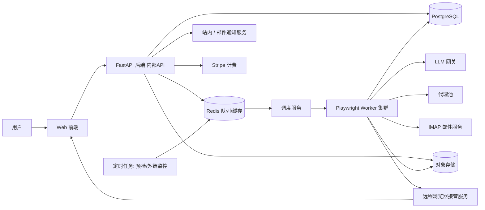
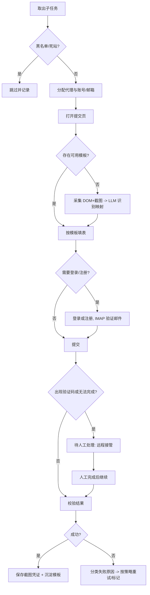

# AutoLink 产品需求文档（PRD）

> 版本：v0.2（草案）　日期：2026-10-15
> 状态：关键决策已确认（见第 9 章），暂不进入开发

---

## 1. 产品概述

### 1.1 定位
AutoLink 是一个自研 SaaS 平台，用于**批量将产品信息提交到各类产品收录站点（Product Directory）**，并对提交结果与外链存活进行持续监控。

### 1.2 目标用户
| 用户 | 场景 |
|---|---|
| 独立开发者 / 小团队 | 新产品上线，需要快速获取早期外链与曝光 |
| SEO / 增长从业者 | 管理多个产品，重复提交到数百个站点 |
| 代理商（Agency） | 为多个客户提交产品，需要团队协作与权限隔离 |

### 1.3 核心价值
1. 将“一个站点一个站点手动提交”变为“一次创建任务，批量自动执行”。
2. 通过站点质量评分和黑名单，只提交高价值站点。
3. 通过表单模板缓存降低 LLM 成本、提升速度和成功率。
4. 提供提交凭证和外链监控，形成完整闭环。

### 1.4 产品原则
- **质量优先于数量**：不鼓励无差别灌水，默认过滤低质量站点。
- **人机协同**：遇到验证码、人工审核等情形，转人工接管，**不做验证码破解或绕过**。
- **可审计**：每次提交保留截图、日志、状态变更记录。
- **安全优先**：所有第三方账号、邮箱凭证加密存储，租户严格隔离。

### 1.5 范围边界（Non-goals）
- 不对外开放 API：后端 API 仅供自家前端与内部服务使用，不提供 API Key、开发者文档或第三方集成。
- 不做验证码自动破解 / 打码平台接入。
- 不做评论、论坛、博客等垃圾外链群发（仅限“产品收录类站点”）。
- 不提供伪造流量、刷量等功能。

---

## 2. 功能需求

优先级：**P0**＝MVP 必须；**P1**＝首个商业版本；**P2**＝后续迭代。

### 2.1 站点库管理

| ID | 功能 | 说明 | 优先级 |
|---|---|---|---|
| S-1 | 内置站点库 | 平台预录入一批高质量收录站点，由运营团队**人工**在运营后台维护，全租户只读可用 | P0 |
| S-2 | 自定义站点库 | 用户通过 CSV/Excel 上传或手动添加站点，仅本租户（团队）可见；自动去重（按域名规范化） | P0 |
| S-3 | 站点预检任务 | 批量检测：域名连通性、提交页存活、HTTP 状态码、重定向链、响应耗时；失败达阈值自动标记“死站”并从可用池剔除 | P0 |
| S-4 | 站点标签 | 是否需注册、是否需邮箱验证、是否有验证码、是否需人工审核、是否收费、是否 dofollow、语言、分类 | P0 |
| S-5 | 站点评分 | **暂不对接**第三方 SEO 数据 API，后续再做（届时对接一家，通过适配器隔离）。首版站点表保留 DR/流量/垃圾度字段，由运营手动录入并可用于筛选 | P2 |
| S-6 | 定期复检 | 定时重新预检与重新评分（如每周/每月） | P1 |
| S-7 | 站点黑名单 | 识别并标记垃圾站，黑名单站点不再参与提交；支持全局黑名单（运营）与租户黑名单 | P1 |

**字段（站点）**：域名、提交页 URL、分类、语言、标签、DR、流量、垃圾度、状态（正常/死站/黑名单）、最近预检时间、来源（内置/自定义）。

**验收要点**
- 导入 600+ 站点后，预检任务可在可配置并发下完成，并给出每个站点的状态与原因。
- 死站自动剔除，且用户可手动恢复。

### 2.2 产品资料管理

| ID | 功能 | 说明 | 优先级 |
|---|---|---|---|
| P-1 | 产品档案 | 名称、短描述、长描述、官网链接、Logo、关键词、行业分类、联系方式（邮箱/电话/社媒） | P0 |
| P-2 | 多版本文案 | 每个产品可维护多套名称/短/长描述；提交时按策略（随机/轮询/按站点固定）选取，降低重复文本风险 | P0 |
| P-3 | 图片管理 | Logo 上传、裁剪，自动生成多尺寸（如 64/128/256/512，PNG/WebP），表单上传时按站点要求自动选取 | P0 |
| P-4 | AI 文案变体生成（可选） | 基于主文案用 LLM 生成多版本改写，用户确认后入库 | P2 |
| P-5 | 截图/素材库 | 产品截图、封面图，用于需要多图的站点 | P1 |

### 2.3 账号与邮箱池管理

| ID | 功能 | 说明 | 优先级 |
|---|---|---|---|
| A-1 | 邮箱池 | 批量导入 IMAP 邮箱（地址、密码/应用专用密码、服务器）；用于站点注册与验证邮件接收 | P0 |
| A-2 | 自动验证邮件处理 | 轮询 IMAP，匹配站点发信，解析并访问验证链接/验证码；超时则转人工 | P0 |
| A-3 | 站点账号池 | 按“租户 + 站点 + 产品”维度存储用户名/密码、登录状态（cookies/storage state）；支持自动登录与会话复用 | P0 |
| A-4 | 自动注册 | 需注册的站点，使用邮箱池自动完成注册（LLM 识别注册表单），遇验证码转人工。**已确认后置，首版不做**；首版需注册站点由用户手动注册后录入站点账号（A-3） | P2 |
| A-5 | 账号健康监控 | 定期检测邮箱可登录性、站点账号可用性（被封/密码失效）；异常站内+邮件告警 | P1 |
| A-6 | 邮箱分配策略 | 一邮箱绑定多站点数量上限、避免同一邮箱短时间大量注册 | P1 |

**安全要求**：所有凭证使用信封加密（AES-256-GCM + KMS/主密钥），界面默认不回显明文，操作留审计日志。

### 2.4 自动化提交引擎（核心）

#### 2.4.1 任务与调度
| ID | 功能 | 说明 | 优先级 |
|---|---|---|---|
| E-1 | 创建提交任务 | 选择站点来源（平台库 / 自定义 / 混合，支持按标签、DR、分类筛选）+ 产品档案 + 文案策略 | P0 |
| E-2 | 任务队列 | 任务拆分为“站点级子任务”，入队并按租户配额公平调度 | P0 |
| E-3 | 任务控制 | 并发上限、站点间隔延时（默认 10~40s 随机，可配置）、暂停/恢复/取消 | P0 |
| E-4 | 代理 IP 轮换 | 采购**第三方代理服务**构建平台代理池；按子任务/站点绑定出口 IP，同站点同出口限速；代理成本计入套餐 | P1 |
| E-5 | 重试策略 | 可配置自动重试次数与退避；区分可重试与不可重试错误 | P0 |

#### 2.4.2 LLM 智能表单识别
| ID | 功能 | 说明 | 优先级 |
|---|---|---|---|
| E-6 | 页面感知 | Playwright 获取精简 DOM（可访问性树 + 表单元素：label、name、placeholder、type、options 等）；页面截图仅在需要时采集 | P0 |
| E-7 | 表单识别 | 分层策略以降低成本：①启发式规则（label/name/placeholder 关键词匹配）→ ②**纯文本 LLM** 基于精简 DOM 输出结构化映射（每个输入控件 → 语义字段：名称、简介、官网、邮箱、分类、Logo 等）→ ③置信度低或 DOM 无法表达（Canvas、自绘控件、强样式依赖）时才升级到**视觉模型**（DOM + 截图）→ ④仍失败转人工接管 | P0 |
| E-8 | 字段自动映射 | 产品字段填充到对应控件：文本、下拉、单选、复选、文件上传（Logo）、富文本编辑器 | P0 |
| E-9 | 多步表单 | 支持分步/向导式表单、翻页与条件显示字段 | P1 |
| E-10 | 提交后校验 | 识别成功提示/错误提示（DOM + 截图 + LLM），判定成功/失败/待审核 | P0 |

#### 2.4.3 结果、失败与人工接管
| ID | 功能 | 说明 | 优先级 |
|---|---|---|---|
| E-11 | 提交凭证 | 成功后保存全页截图、最终 URL、响应摘要，生成可访问链接 | P0 |
| E-12 | 失败分类 | 验证码 / 站点不可访问 / 表单校验错误 / 需付费 / 需登录失败 / 识别失败 / 其他，并保存失败截图与日志 | P0 |
| E-13 | 手动接管 | 检测到验证码或无法自动完成时，任务置为“待人工处理”；用户通过**远程浏览器视图**（实时画面 + 键鼠转发）完成后，点击“继续”恢复执行 | P0 |
| E-14 | 接管会话管理 | 接管会话超时回收、并发接管数限制、操作审计 | P1 |

#### 2.4.4 差异化：表单模板缓存
| ID | 功能 | 说明 | 优先级 |
|---|---|---|---|
| E-15 | 模板沉淀 | 首次成功提交（含人工修正）后保存表单映射（选择器、字段、步骤）为站点模板 | P1 |
| E-16 | 模板复用 | 后续提交优先使用模板，直接填表，不调用 LLM；模板失效（选择器丢失/校验失败）自动回退到 LLM 并更新模板 | P1 |
| E-17 | 模板共享 | 内置站点的模板由平台共享给所有租户（不含任何租户数据） | P2 |

### 2.5 提交结果与外链监控

| ID | 功能 | 说明 | 优先级 |
|---|---|---|---|
| R-1 | 任务报表 | 成功 / 失败 / 待人工 / 待审核数量与明细；失败原因分布；支持筛选 | P0 |
| R-2 | CSV 导出 | 导出任务结果（站点、状态、时间、凭证链接、收录链接、失败原因） | P0 |
| R-3 | 收录链接记录 | 记录产品在站点上的收录页 URL（自动抓取或手动补录） | P1 |
| R-4 | 外链存活监控 | 定时爬取收录页，检测是否存在指向官网的链接、rel 属性（nofollow/dofollow）、锚文本 | P1 |
| R-5 | 外链状态 | 在线 / 已删除 / 404 / 待审核，状态变更时站内与邮件通知 | P1 |
| R-6 | 收录趋势 | 按时间展示外链总数、存活率、新增/丢失趋势 | P2 |

### 2.6 用户与团队系统

| ID | 功能 | 说明 | 优先级 |
|---|---|---|---|
| U-1 | 注册登录 | 邮箱注册、验证、找回密码；支持 Google / GitHub OAuth；可选 2FA | P0 |
| U-2 | 套餐与计费 | 免费额度 / Pro / Agency；按“月度提交次数 + 产品数 + 席位数 + 高级功能”限制；仅 **Stripe** 订阅、发票、用量统计 | P0 |
| U-7 | 国际化（i18n） | 界面、邮件通知、错误提示支持**中文 / 英文**双语，用户可切换；文案资源统一管理 | P0 |
| U-3 | 团队协作 | 工作区（Workspace）、成员邀请、角色（Owner / Admin / Member / Viewer）、共享站点库与产品档案、操作审计 | P1 |
| U-5 | Webhook | **API 不对外开放**，该项降级：仅作为可选的任务完成/失败通知渠道（HMAC 签名、重试与投递日志），首版不做 | P2 |
| U-6 | 运营后台 | 内置站点库维护、全局黑名单、用户/套餐管理、任务监控、成本监控 | P0 |

### 2.7 增值功能汇总
- 表单模板缓存（E-15 ~ E-17）
- 站点黑名单（S-7）
- 站点质量评分与过滤（S-5，后续迭代）
- 多版本文案轮换（P-2）

---

## 3. 非功能需求

| 维度 | 要求 |
|---|---|
| 多租户隔离 | 所有业务表带 `workspace_id`；数据库层行级隔离（RLS）+ 应用层鉴权双重保障 |
| 安全 | 符合 OWASP Top 10；凭证加密存储；传输 TLS；CSRF/XSS/SSRF 防护（爬取任意 URL 必须做 SSRF 防护，禁止访问内网地址）；密钥轮换 |
| 性能 | 单 Worker 并发可配置；任务调度延迟 < 5s；API P95 < 500ms |
| 可扩展 | 浏览器 Worker 水平扩展；队列与存储可独立扩容 |
| 可靠性 | 任务幂等、断点续跑；Worker 崩溃后子任务可重新调度；数据每日备份 |
| 可观测 | 结构化日志、指标（成功率、LLM 成本、队列堆积）、错误追踪、告警 |
| 成本控制 | 每任务 LLM/代理/评分 API 成本记录；套餐按成本核算；模板缓存降低 LLM 调用 |
| 合规 | 隐私政策与服务条款；数据导出与删除（GDPR）；明确提示用户需遵守目标站点条款 |

---

## 4. 技术方向

### 4.1 技术选型（建议）

| 层 | 选型 | 说明 |
|---|---|---|
| 前端 | Next.js + TypeScript + Tailwind + shadcn/ui + next-intl | 仪表盘、数据表格、任务看板；中英双语 |
| 后端 API | Python + FastAPI + Pydantic | 与 Playwright、LLM 生态一致 |
| 数据库 | PostgreSQL（含 RLS） | 主业务数据 |
| 缓存/队列 | Redis + Celery（或 Dramatiq / Arq） | 任务队列、限流、分布式锁；后期可评估 Temporal 做长流程编排 |
| 浏览器引擎 | Playwright（Chromium）容器集群 | 每个子任务独立 BrowserContext；容器化、可水平扩展 |
| 人工接管 | CDP Screencast / noVNC 远程浏览器视图 | 在网页内实时查看并操作 Worker 浏览器 |
| 对象存储 | MinIO（S3 兼容，自有服务器） | 截图、Logo、导出文件；以后可无缝迁移到云对象存储 |
| LLM | 通过 **OpenRouter** 统一接入多模型，自建薄网关层；**文本模型为主、视觉模型兜底**（需支持结构化输出） | 缓存、模型降级、按任务成本计量；遵循 OpenRouter 的配置与数据策略 |
| 邮件收取 | IMAP（aioimaplib / imaplib） | 验证邮件解析 |
| 邮件发送 | SES / Resend | 通知、验证、告警 |
| 计费 | Stripe | 订阅、用量、发票 |
| 代理 | 第三方代理服务商（住宅/数据中心 IP） | 通过适配器接入，支持按站点绑定 |
| 部署 | **自有服务器**（Docker Compose 起步，规模上来后再评估 Kubernetes） | Worker 独立扩缩容；需自行负责备份、监控、网络安全与带宽 |
| 观测 | Sentry + Prometheus + Grafana + 结构化日志 | |

### 4.2 系统架构

### 4.3 单站点提交流程

### 4.4 核心数据模型（概要）

- `users`、`workspaces`、`memberships`（角色）、`subscriptions`、`usage_records`
- `products`、`product_copies`（多版本文案）、`product_assets`（图片及多尺寸）
- `sites`（内置/自定义）、`site_tags`、`site_checks`（预检历史）、`site_metrics`（DR/流量/垃圾度）、`site_blacklist`
- `site_form_templates`（表单模板，含版本与有效性）
- `mailboxes`、`site_accounts`（加密凭证、session state）、`account_health_checks`
- `tasks`、`task_items`（站点级子任务）、`task_events`（状态流水）、`submissions`（凭证、收录 URL）
- `backlinks`、`backlink_checks`
- `api_keys`、`webhooks`、`webhook_deliveries`、`notifications`、`audit_logs`

### 4.5 关键技术难点与对策

| 难点 | 对策 |
|---|---|
| 表单千差万别，LLM 成本高、不稳定 | 先抽取精简 DOM + 启发式规则，LLM 仅处理不确定部分；结果结构化校验；成功后沉淀模板，后续不再调用 LLM |
| 验证码、反爬 | 不做破解；检测后转人工接管；通过合理速率、代理、真实浏览器指纹降低触发率 |
| 人工接管体验 | 远程浏览器视图（CDP screencast/noVNC），会话超时回收，接管期间暂停任务超时计时 |
| IP 封禁 | 代理池、每站点串行 + 随机延时、同一站点同一出口限速 |
| 凭证安全 | 信封加密、最小权限、操作审计、禁止日志输出明文 |
| 外部站点不可信（SSRF/恶意脚本） | Worker 容器网络隔离（禁止访问内网与元数据地址）、资源与时间限制、无特权运行 |
| LLM 成本与稳定性 | 分层识别（规则 → 文本 LLM → 视觉 LLM），视觉模型仅兜底；模板缓存命中后不再调用 LLM；按任务设置成本上限 |
| 租户配额与公平性 | 队列按租户加权公平调度，套餐对应并发与速率上限 |

---

## 5. 套餐与计费（草案，待商业验证）

| 项目 | Free | Pro | Agency |
|---|---|---|---|
| 提交次数 | 免费提交 2 次（统计口径待确认） | 中等（按月） | 大量 / 按量加购（按月） |
| 产品数 | 1 | 若干 | 多 |
| 团队席位 | 1 | 少量 | 多 |
| 自定义站点库 | 有限 | 是 | 是 |
| 外链监控 | 否 | 是 | 是 |
| 表单模板缓存 | 是 | 是 | 是 |
| 代理 | 平台共享池（限速） | 平台共享池 | 平台共享池（更高配额） |
| 具体数值 | 待成本测算后确定 | | |

---

## 6. 风险与合规

1. **目标站点条款**：部分站点禁止自动提交。需提供站点级“仅人工提交”标记，并在 ToS 中要求用户自行承担遵守责任。
2. **垃圾外链风险**：大规模低质提交可能损害用户 SEO。通过评分过滤、黑名单、速率限制、多文案轮换缓解。
3. **验证码**：不绕过，转人工。
4. **数据与隐私**：存储第三方账号和邮箱凭证属敏感数据，必须加密并提供删除能力。
5. **成本风险**：LLM 与代理成本需按任务核算，防止免费套餐被滥用（邮箱验证、每人/每设备/每 IP 限制、其他风控）。
6. **自有服务器运维风险**：单机/少量机器的可用性、备份、DDoS 与带宽；Worker 访问不可信网站，必须做网络隔离。
7. **平台滥用**：对异常任务量、可疑内容（违法/欺诈产品）做审核与封禁机制。

---

## 7. 里程碑建议

| 阶段 | 内容 | 目标 |
|---|---|---|
| M0 | 技术验证 | 选 20~30 个代表站点，验证 LLM（OpenRouter）识别 + Playwright 填表成功率、**远程浏览器接管**可行性、代理效果、成本测算 |
| M1（MVP） | P0 功能：账号体系、中英双语、站点库（导入/预检/标签）、产品档案、邮箱与站点账号池、提交引擎（含远程浏览器接管）、任务报表与 CSV、Stripe 基础计费 | 内部/种子用户可完整跑通一次批量提交 |
| M2 | 模板缓存、黑名单、外链监控与通知、团队协作 | 提升成功率与可运营性 |
| M3 | 套餐计费完善、运营后台完善 | 具备商业化条件 |
| M4 | 站点评分（对接一家 SEO 数据 API）、模板共享、AI 文案变体、收录趋势、Webhook（可选） | 差异化与增长 |

---

## 8. 成功指标

- 自动提交成功率（含自动重试）≥ 目标值（M0 验证后确定）
- 单次提交的平均 LLM 成本、模板命中率
- 人工接管比例与平均接管耗时
- 外链存活率
- 付费转化率、留存、每用户月均提交量

---

## 9. 已确认决策

| # | 议题 | 决策 | 对文档的影响 |
|---|---|---|---|
| 1 | 内置站点库来源 | 人工运营维护 | S-1；运营后台需提供高效的站点录入/审核工具 |
| 2 | 代理 IP | 采购第三方代理服务 | E-4；需做代理适配器与成本核算 |
| 3 | 自动注册 | 后置，首版不做 | A-4 降为 P2 |
| 4 | LLM 与部署 | 通过 OpenRouter 接入；部署在自有服务器 | 4.1 技术选型；新增运维风险 |
| 5 | 语言与支付 | 中英双语；仅 Stripe | 新增 U-7；U-2 |
| 6 | 手动接管 | 首版即做远程浏览器接管 | E-13 保持 P0，M0 重点验证 |
| 7 | 站点评分 | 暂不对接，后续再做 | S-5 降为 P2，从 M2 移至 M4 |
| 8 | API 开放 | 不对外开放 | 移除 U-4；U-5 Webhook 降为 P2；增加 Non-goal |
| 9 | 识别模型 | 不只依赖视觉模型：规则 → 文本 LLM → 视觉兜底 | E-6、E-7；成本控制 |
| 10 | 免费套餐 | 免费提交 2 次 | 第 5 章 |

## 10. 待确认问题

1. 免费 2 次提交是**终身总共 2 次**，还是**每月 2 次**？（“提交”按一个站点算一次，还是按一个任务算一次？）
2. 自有服务器的规格与数量（CPU/内存/带宽）？是否有公网固定 IP 与机房位置？这决定 Worker 并发上限与代理方案。
3. OpenRouter 默认的文本模型、视觉兜底模型与单任务成本上限？（M0 实测后确定。）
4. Webhook（U-5）是否完全删除，还是保留为后期可选的通知渠道？
5. 面向海外用户时，隐私合规范围（GDPR/CCPA）与所需法务文本？
