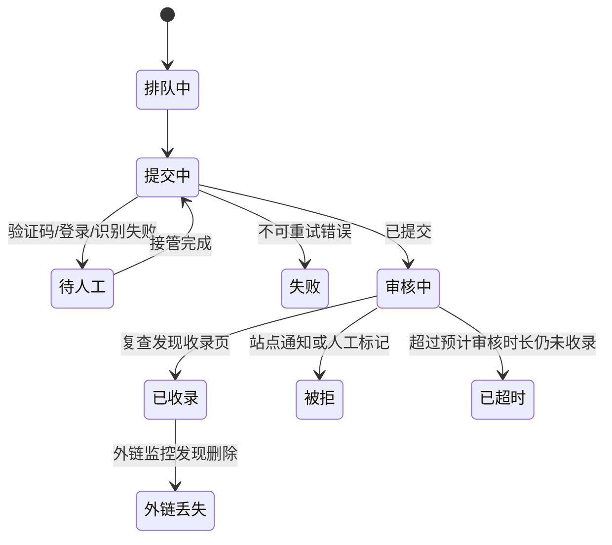
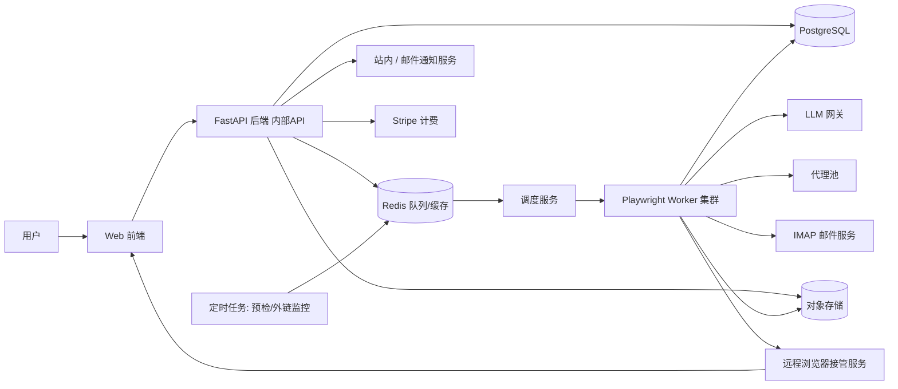
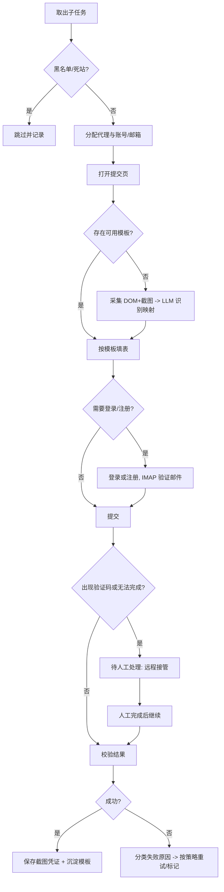

# AutoLink 产品需求文档（PRD）

> 版本：v0.4（草案）　日期：2026-10-15
> 状态：关键决策已确认（见第 9 章），暂不进入开发
> v0.4 变更：套餐改为一次性付费四档（Free / Basic / Pro / Max，第 5 章）；站点库对所有人公开用于引流（S-10）；多产品层级与产品切换（P-6）
> v0.3 变更：基于真实提交数据（附录 A）补充站点标签、导入清洗、提交状态生命周期、备注、反链徽章、打榜、产品×站点矩阵、历史记录导入

---

## 1. 产品概述

### 1.1 定位
AutoLink 是一个自研 SaaS 平台，用于**批量将产品信息提交到各类产品收录站点（Product Directory）**，并对提交结果与外链存活进行持续监控。

### 1.2 目标用户
| 用户 | 场景 |
|---|---|
| 独立开发者 / 小团队 | 新产品上线，需要快速获取早期外链与曝光 |
| SEO / 增长从业者 | 管理多个产品，重复提交到数百个站点 |
| 代理商（Agency） | 为多个客户提交产品，需要团队协作与权限隔离 |

### 1.3 核心价值
1. 将“一个站点一个站点手动提交”变为“一次创建任务，批量自动执行”。
2. 通过站点质量评分和黑名单，只提交高价值站点。
3. 通过表单模板缓存降低 LLM 成本、提升速度和成功率。
4. 提供提交凭证和外链监控，形成完整闭环。

### 1.4 产品原则
- **质量优先于数量**：不鼓励无差别灌水，默认过滤低质量站点。
- **头部平台不自动化**：Product Hunt、BetaList、AlternativeTo、Indie Hackers、There's An AI For That 等头部平台（站点标记 `submit_mode=manual`，见 S-12）曝光集中、审核看重内容质量和发布时机，发布机会往往只有一次，**不做自动提交**；由用户亲自精发，AutoLink 只提供提交指南、产品档案素材、发布提醒与状态记录，不消耗自动提交额度。
- **人机协同**：遇到验证码、人工审核等情形，转人工接管，**不做验证码破解或绕过**。
- **可审计**：每次提交保留截图、日志、状态变更记录。
- **安全优先**：所有第三方账号、邮箱凭证加密存储，租户严格隔离。

### 1.5 范围边界（Non-goals）
- 不对外开放 API：后端 API 仅供自家前端与内部服务使用，不提供 API Key、开发者文档或第三方集成。
- 不做验证码自动破解 / 打码平台接入。
- 不做评论、论坛、博客等垃圾外链群发（仅限“产品收录类站点”）。
- 不提供伪造流量、刷量等功能。
- 不提供打榜自动投票、刷票、互刷（仅做发布提醒与结果记录）。

---

## 2. 功能需求

优先级：**P0**＝MVP 必须；**P1**＝首个商业版本；**P2**＝后续迭代。

### 2.1 站点库管理

| ID | 功能 | 说明 | 优先级 |
|---|---|---|---|
| S-1 | 内置站点库 | 平台预录入一批高质量收录站点，由运营团队**人工**在运营后台维护，全租户只读可用 | P0 |
| S-2 | 自定义站点库 | 用户通过 CSV/Excel 上传或手动添加站点，仅本租户（团队）可见；导入时自动清洗（见 S-8）并按规范化域名去重 | P0 |
| S-3 | 站点预检任务 | 批量检测：域名连通性、提交页存活、HTTP 状态码、重定向链、响应耗时；失败达阈值自动标记“死站”并从可用池剔除 | P0 |
| S-4 | 站点标签 | 是否需注册、**登录方式**（无需登录 / 邮箱+密码 / 邮件验证码 / Google / GitHub / 其他 OAuth）、是否需邮箱验证、是否有验证码、是否需人工审核、**收费模式**（免费 / 付费 / 反链免费 / 付费加急 / 付费但定期免费窗口）、**是否要求反链/徽章**、**是否需站长验证**（DNS / meta 代码）、**是否支持打榜**（按发布日排队/投票排名）、**典型审核时长**、**提交前置条件**（如“点赞 N 天解锁提交”、需视频）、是否 dofollow、语言、分类 | P0 |
| S-5 | 站点评分 | **暂不对接**第三方 SEO 数据 API，后续再做（届时对接一家，通过适配器隔离）。首版站点表保留 DR/流量/垃圾度字段，由运营手动录入并可用于筛选 | P2 |
| S-6 | 定期复检 | 定时重新预检与重新评分（如每周/每月） | P1 |
| S-7 | 站点黑名单 | 识别并标记垃圾站，黑名单站点不再参与提交；支持全局黑名单（运营）与租户黑名单 | P1 |
| S-8 | 导入清洗 | 导入 CSV/Excel 时：① 列自动识别并可手动映射（链接/名称/分类/状态/备注等）；② URL 修复（`https:/` 单斜杠、多余空格、缺少协议）；③ 去掉追踪参数（`ref`、`utm_*` 等）与 `www.`，按规范化域名去重；④ 区分“分类”与“站点名”；⑤ 从备注中提取登录方式、收费、反链、审核时长、发布日期等作为**建议标签**供用户确认；⑥ 无法识别的行单独列出（如域名缺少点号）；⑦ 备注中疑似密码按 N-3 处理 | P0 |
| S-9 | 站点成功率统计 | 基于平台内真实提交结果（匿名聚合）统计各站收录率、实际审核时长中位数，作为站点排序与筛选依据（先于第三方 SEO 评分上线） | P1 |
| S-10 | 公开站点库 | 内置站点库**无需登录即可浏览**（`/sites`），用于 SEO 与引流：**只展示站点名称与链接**（头部平台加“头部平台”标记），按页展示（每页 60 个，`?page=` 数字分页），不提供筛选，不公开收费模式、登录方式、反链要求、验证状态等标签；标签、搜索、筛选与站点详情在登录后的控制台站点库中提供。页内提供“用 AutoLink 自动提交”入口。不公开任何租户的产品名、提交记录、备注与账号；对列表做限速防整库抓取，整库 CSV 导出需登录 | P0 |
| S-11 | 验证状态 | 站点分为“已验证收录”（平台内有收录记录）、“已提交过”（有提交但尚无收录）、“未验证”（从未提交）；种子库中未实际提交过的站点一律标为“未验证”（见第 10 章问题 6） | P0 |
| S-12 | 头部平台手动精发 | 站点增加“提交方式”：`auto`（自动提交）/ `manual`（头部平台 · 手动精发）。首批 manual 名单由运营维护（Product Hunt、BetaList、AlternativeTo、Indie Hackers、Crunchbase、F6S、G2、Capterra、AppSumo、Toolify、Futurepedia、There's An AI For That、FutureTools、SaaSHub、Peerlist、DevHunt、Microlaunch、StackShare、GitHub、Hacker News、Reddit）。manual 站点：站点库与详情页显示标记和说明，可按提交方式筛选；不进入自动提交任务（引擎直接记为 manual_only，不访问、不填表），不扣额度；用户可手动记录提交状态与发布日 | P0 |

**字段（站点）**：域名、名称、提交页 URL、分类、语言、标签（含 S-4 各项）、典型审核时长、徽章要求说明、DR、流量、垃圾度、状态（正常/需复核/死站/黑名单）、最近预检时间、来源（内置/自定义）、平台收录率（S-9）。

**验收要点**
- 导入 600+ 站点后，预检任务可在可配置并发下完成，并给出每个站点的状态与原因。
- 死站自动剔除，且用户可手动恢复。
- 导入附录 A 的真实表格时，11 条格式错误的 URL 自动修复，重复域名合并，备注中的密码不会以明文出现在备注里。

### 2.2 产品资料管理

| ID | 功能 | 说明 | 优先级 |
|---|---|---|---|
| P-1 | 产品档案 | 必填：名称、官网、一句话描述（≤100 字符）、一段话介绍（≤500）、主分类、定价模式、联系邮箱；选填：详细介绍（≤5000）、关键词标签（≤10）、目标受众、主要功能（≤8 条）、竞品/替代品、价格说明、支持平台（Web/iOS/Android/macOS/Windows/Linux/浏览器插件/API/CLI）、创始人姓名、所在国家、X/LinkedIn/GitHub/Discord、演示视频、Logo、产品截图、内部备注。内容用英文填写；引擎按表单字段长度自动在长/短描述间取用或在句子边界截断，多选项（平台/分类）只勾选与档案匹配的项 | P0 |
| P-2 | 多版本文案 | 每个产品可维护多套名称/短/长描述；提交时按策略（随机/轮询/按站点固定）选取，降低重复文本风险 | P0 |
| P-3 | 图片管理 | Logo 上传、裁剪，自动生成多尺寸（如 64/128/256/512，PNG/WebP），表单上传时按站点要求自动选取 | P0 |
| P-4 | AI 文案变体生成（可选） | 基于主文案用 LLM 生成多版本改写，用户确认后入库 | P2 |
| P-5 | 截图/素材库 | 产品截图、封面图，用于需要多图的站点 | P1 |
| P-6 | 多产品层级与切换 | 见下方“多产品展示层级” | P0 |

**多产品展示层级**

```
工作区（套餐、提交额度、成员、站点账号、自定义站点）
└─ 产品（档案、多版本文案、素材、产品备注）
   └─ 产品 × 站点 提交记录（状态、时间线、备注、徽章、发布日/名次、收录链接）
```

- **额度在工作区层级**计算（产品数、提交次数），在产品层级展示各自消耗。
- **产品切换器**：控制台顶栏全局可见，含“全部产品”、各产品、“新建产品”；产品数达到套餐上限时“新建”变为升级入口。
- **三种视图**：① 全部产品总览（每个产品一张卡片：已收录/审核中/失败、额度消耗、待办徽章、下一个发布日）；② 单产品详情（概览 / 资料 / 提交记录 / 徽章与打榜）；③ 产品 × 站点矩阵（R-7），用于跨产品对比与补交。
- **站点库在产品上下文中**显示当前产品在每个站的状态（未提交/审核中/已收录…），并可直接勾选创建提交任务。
- 任务始终属于单个产品；“多产品同时提交”在界面上拆成多个任务。

### 2.3 账号与邮箱池管理

| ID | 功能 | 说明 | 优先级 |
|---|---|---|---|
| A-1 | 邮箱池 | 批量导入 IMAP 邮箱（地址、密码/应用专用密码、服务器）；用于站点注册与验证邮件接收 | P0 |
| A-2 | 自动验证邮件处理 | 轮询 IMAP，匹配站点发信，解析并访问验证链接/验证码；超时则转人工 | P0 |
| A-3 | 站点账号池 | 按“租户 + 站点 + 产品”维度存储用户名/密码、登录方式、使用的身份（如哪个 Google 账号）、登录状态（cookies/storage state）；支持自动登录与会话复用。**第三方 OAuth（Google 等）不做自动登录**：首次由用户通过远程接管（E-13）登录，之后复用保存的会话，失效时再转人工 | P0 |
| A-4 | 自动注册 | 需注册的站点，使用邮箱池自动完成注册（LLM 识别注册表单），遇验证码转人工。**已确认后置，首版不做**；首版需注册站点由用户手动注册后录入站点账号（A-3） | P2 |
| A-5 | 账号健康监控 | 定期检测邮箱可登录性、站点账号可用性（被封/密码失效）；异常站内+邮件告警 | P1 |
| A-6 | 邮箱分配策略 | 一邮箱绑定多站点数量上限、避免同一邮箱短时间大量注册 | P1 |

**安全要求**：所有凭证使用信封加密（AES-256-GCM + KMS/主密钥），界面默认不回显明文，操作留审计日志。

### 2.4 自动化提交引擎（核心）

#### 2.4.1 任务与调度
| ID | 功能 | 说明 | 优先级 |
|---|---|---|---|
| E-1 | 创建提交任务 | 选择站点来源（平台库 / 自定义 / 混合，支持按标签、DR、分类筛选）+ 产品档案 + 文案策略 | P0 |
| E-2 | 任务队列 | 任务拆分为“站点级子任务”，入队并按租户配额公平调度 | P0 |
| E-3 | 任务控制 | 并发上限、站点间隔延时（默认 10~40s 随机，可配置）、暂停/恢复/取消 | P0 |
| E-4 | 代理 IP 轮换 | 采购**第三方代理服务**构建平台代理池；按子任务/站点绑定出口 IP，同站点同出口限速；代理成本计入套餐 | P1 |
| E-5 | 重试策略 | 可配置自动重试次数与退避；区分可重试与不可重试错误 | P0 |

#### 2.4.2 LLM 智能表单识别
| ID | 功能 | 说明 | 优先级 |
|---|---|---|---|
| E-6 | 页面感知 | Playwright 获取精简 DOM（可访问性树 + 表单元素：label、name、placeholder、type、options 等）；页面截图仅在需要时采集 | P0 |
| E-7 | 表单识别 | 分层策略以降低成本：①启发式规则（label/name/placeholder 关键词匹配）→ ②**纯文本 LLM** 基于精简 DOM 输出结构化映射（每个输入控件 → 语义字段：名称、简介、官网、邮箱、分类、Logo 等）→ ③置信度低或 DOM 无法表达（Canvas、自绘控件、强样式依赖）时才升级到**视觉模型**（DOM + 截图）→ ④仍失败转人工接管 | P0 |
| E-8 | 字段自动映射 | 产品字段填充到对应控件：文本、下拉、单选、复选、文件上传（Logo）、富文本编辑器 | P0 |
| E-9 | 多步表单 | 支持分步/向导式表单、翻页与条件显示字段 | P1 |
| E-10 | 提交后校验 | 识别成功提示/错误提示（DOM + 截图 + LLM），判定为“已提交·审核中”/“已收录”/失败；识别站点给出的预计审核时长或发布日期并记录 | P0 |

#### 2.4.3 结果、失败与人工接管
| ID | 功能 | 说明 | 优先级 |
|---|---|---|---|
| E-11 | 提交凭证 | 成功后保存全页截图、最终 URL、响应摘要，生成可访问链接 | P0 |
| E-12 | 失败分类 | 验证码 / 站点不可访问 / 表单校验错误 / 需付费 / 需登录失败 / 识别失败 / 其他，并保存失败截图与日志 | P0 |
| E-13 | 手动接管 | 检测到验证码或无法自动完成时，任务置为“待人工处理”；用户通过**远程浏览器视图**（实时画面 + 键鼠转发）完成后，点击“继续”恢复执行 | P0 |
| E-14 | 接管会话管理 | 接管会话超时回收、并发接管数限制、操作审计 | P1 |

#### 2.4.4 差异化：表单模板缓存
| ID | 功能 | 说明 | 优先级 |
|---|---|---|---|
| E-15 | 模板沉淀 | 首次成功提交（含人工修正）后保存表单映射（选择器、字段、步骤）为站点模板 | P1 |
| E-16 | 模板复用 | 后续提交优先使用模板，直接填表，不调用 LLM；模板失效（选择器丢失/校验失败）自动回退到 LLM 并更新模板 | P1 |
| E-17 | 模板共享 | 内置站点的模板由平台共享给所有租户（不含任何租户数据） | P2 |

#### 2.4.5 提交状态生命周期

真实数据显示超过一半的提交长期处于“审核中”（72 小时 ~ 180 天+），因此“提交成功”不等于“已收录”。单站点提交（`task_items`）状态如下：



| ID | 功能 | 说明 | 优先级 |
|---|---|---|---|
| E-18 | 审核中复查 | 对“审核中”的提交按站点典型审核时长安排复查：在站内搜索产品名或访问预期收录页，发现后自动转“已收录”并记录收录页 URL；也支持用户手动改状态 | P1 |
| E-19 | 状态来源与时间线 | 每次状态变更记录来源（自动/复查/用户手动）与时间，在提交详情中以时间线展示 | P0 |

### 2.5 备注

用户在真实工作中大量使用备注记录站点特点与提交情况（如“可以收藏”“点赞 5 天解锁提交”“用哪个账号登录的”），备注为自由文本，由用户自己填写。

| ID | 功能 | 说明 | 优先级 |
|---|---|---|---|
| N-1 | 多处备注 | 可在**站点**（对本工作区可见，内置站点也可加私有备注）、**单次提交**（某产品在某站点）、**产品**、**任务**上添加备注；支持多条、显示作者与时间、可编辑删除 | P0 |
| N-2 | 备注检索与展示 | 站点列表、提交列表中显示最新备注摘要；支持按备注关键词搜索与筛选；CSV 导出包含备注 | P0 |
| N-3 | 敏感信息提示 | 保存备注时检测疑似密码/令牌（如“密码：xxx”或混合大小写+数字+符号的长串），提示“转存到站点账号”（A-3，加密保存且默认不回显）；用户可一键转存，也可忽略后继续保存。批量导入时同样检测并给出转存建议 | P0 |
| N-4 | 备注转标签建议 | 备注中出现可结构化的信息（登录方式、反链免费、审核时长、发布日期）时，提示用户一键写入对应字段，备注原文保留 | P2 |

**说明**：备注属于租户数据，受工作区隔离保护；内置站点上的私有备注不会对其他租户或运营的公共站点信息可见。

### 2.6 反链徽章与打榜

| ID | 功能 | 说明 | 优先级 |
|---|---|---|---|
| B-1 | 徽章代码收集 | 要求反链的站点，提交后保存该站为本产品生成的徽章 HTML（自动抓取或用户粘贴），一键复制；展示时做转义，不在平台内渲染第三方 HTML | P1 |
| B-2 | 徽章待办 | 按产品列出“需放置 / 已放置 / 已收录”的徽章清单，对应真实表格中的“收录 / 反链”两列 | P1 |
| B-3 | 徽章存在性检测 | 定期抓取用户官网（或指定页面），检测是否存在指向该站点的链接；缺失时提醒（可能导致收录被撤）。抓取需做 SSRF 防护 | P1 |
| B-4 | 站长验证引导 | 需 DNS / meta 代码验证的站点，展示需添加的记录并检测是否生效，生效后继续提交流程 | P1 |
| L-1 | 发布日历 | 发布日期**以站点排期为准**，挂在“产品 × 站点”提交记录上，产品档案不设发布日期字段。来源：提交后从站点确认页/邮件识别（E-10），识别不到时用户可在该提交记录上补录；以日历/列表展示即将发布的站点 | P1 |
| L-2 | 打榜提醒 | 发布前一天与当天站内+邮件提醒（准备社媒宣传、拉票），按用户时区 | P1 |
| L-3 | 打榜结果 | 记录最终名次/获得的徽章（如 Featured / Top 3），可手动填写 | P2 |

**合规边界**：只做提醒与记录，**不提供自动投票、刷票或互刷**（见 1.5 Non-goals）。

### 2.7 提交结果与外链监控

| ID | 功能 | 说明 | 优先级 |
|---|---|---|---|
| R-1 | 任务报表 | 已收录 / 审核中 / 失败 / 待人工 / 被拒 / 已超时数量与明细；失败原因分布；支持筛选 | P0 |
| R-2 | CSV 导出 | 导出任务结果（站点、状态、时间、凭证链接、收录链接、失败原因、备注、徽章状态、发布日期）；字段顺序与用户现有表格兼容（链接、状态、备注、排名） | P0 |
| R-3 | 收录链接记录 | 记录产品在站点上的收录页 URL（自动抓取或手动补录） | P1 |
| R-4 | 外链存活监控 | 定时爬取收录页，检测是否存在指向官网的链接、rel 属性（nofollow/dofollow）、锚文本 | P1 |
| R-5 | 外链状态 | 在线 / 已删除 / 404 / 待审核，状态变更时站内与邮件通知 | P1 |
| R-6 | 收录趋势 | 按时间展示外链总数、存活率、新增/丢失趋势 | P2 |
| R-7 | 产品×站点矩阵 | 以站点为行、产品为列展示每个产品在每个站点的状态；可筛选“产品 A 已收录但产品 B 未提交”的站点并一键创建补交任务（真实数据中 3 个产品共提交 163 个站点，仅 66 个三者都提交过） | P1 |
| R-8 | 历史提交导入 | 导入用户已有的提交记录表（链接、状态、备注、排名）到指定产品，状态映射到 2.4.5 生命周期，未知站点自动加入自定义站点库，导入后参与复查（E-18）与外链监控 | P1 |

### 2.8 用户与团队系统

| ID | 功能 | 说明 | 优先级 |
|---|---|---|---|
| U-1 | 注册登录 | 邮箱注册、验证、找回密码；支持 Google / GitHub OAuth；可选 2FA | P0 |
| U-2 | 套餐与计费 | Free / Basic / Pro / Max（第 5 章）；**一次性付款，非订阅**；按“产品数 + 提交额度”限制；仅 **Stripe**（Checkout 一次性支付、订单、发票）；额度流水可查 | P0 |
| U-7 | 国际化（i18n） | 界面、邮件通知、错误提示支持**中文 / 英文**双语，用户可切换；文案资源统一管理 | P0 |
| U-3 | 团队协作 | 工作区（Workspace）、成员邀请、角色（Owner / Admin / Member / Viewer）、共享站点库与产品档案、操作审计 | P1 |
| U-5 | Webhook | **API 不对外开放**，该项降级：仅作为可选的任务完成/失败通知渠道（HMAC 签名、重试与投递日志），首版不做 | P2 |
| U-6 | 运营后台 | 内置站点库维护、全局黑名单、用户/套餐管理、任务监控、成本监控 | P0 |

### 2.9 增值功能汇总
- 表单模板缓存（E-15 ~ E-17）
- 站点黑名单（S-7）
- 站点质量评分与过滤（S-5，后续迭代）；平台收录率统计（S-9）
- 多版本文案轮换（P-2）
- 审核中自动复查（E-18）、反链徽章管理（B-1 ~ B-4）、打榜日历（L-1 ~ L-3）、产品×站点矩阵（R-7）

---

## 3. 非功能需求

| 维度 | 要求 |
|---|---|
| 多租户隔离 | 所有业务表带 `workspace_id`；数据库层行级隔离（RLS）+ 应用层鉴权双重保障 |
| 安全 | 符合 OWASP Top 10；凭证加密存储；传输 TLS；CSRF/XSS/SSRF 防护（爬取任意 URL 必须做 SSRF 防护，禁止访问内网地址）；密钥轮换 |
| 性能 | 单 Worker 并发可配置；任务调度延迟 < 5s；API P95 < 500ms |
| 可扩展 | 浏览器 Worker 水平扩展；队列与存储可独立扩容 |
| 可靠性 | 任务幂等、断点续跑；Worker 崩溃后子任务可重新调度；数据每日备份 |
| 可观测 | 结构化日志、指标（成功率、LLM 成本、队列堆积）、错误追踪、告警 |
| 成本控制 | 每任务 LLM/代理/评分 API 成本记录；套餐按成本核算；模板缓存降低 LLM 调用 |
| 合规 | 隐私政策与服务条款；数据导出与删除（GDPR）；明确提示用户需遵守目标站点条款 |

---

## 4. 技术方向

### 4.1 技术选型（建议）

| 层 | 选型 | 说明 |
|---|---|---|
| 前端 | Next.js + TypeScript + Tailwind + shadcn/ui + next-intl | 仪表盘、数据表格、任务看板；中英双语 |
| 后端 API | Python + FastAPI + Pydantic | 与 Playwright、LLM 生态一致 |
| 数据库 | PostgreSQL（含 RLS） | 主业务数据 |
| 缓存/队列 | Redis + Celery（或 Dramatiq / Arq） | 任务队列、限流、分布式锁；后期可评估 Temporal 做长流程编排 |
| 浏览器引擎 | Playwright（Chromium）容器集群 | 每个子任务独立 BrowserContext；容器化、可水平扩展 |
| 人工接管 | CDP Screencast / noVNC 远程浏览器视图 | 在网页内实时查看并操作 Worker 浏览器 |
| 对象存储 | MinIO（S3 兼容，自有服务器） | 截图、Logo、导出文件；以后可无缝迁移到云对象存储 |
| LLM | 通过 **OpenRouter** 统一接入多模型，自建薄网关层；**文本模型为主、视觉模型兜底**（需支持结构化输出） | 缓存、模型降级、按任务成本计量；遵循 OpenRouter 的配置与数据策略 |
| 邮件收取 | IMAP（aioimaplib / imaplib） | 验证邮件解析 |
| 邮件发送 | SES / Resend | 通知、验证、告警 |
| 计费 | Stripe | 订阅、用量、发票 |
| 代理 | 第三方代理服务商（住宅/数据中心 IP） | 通过适配器接入，支持按站点绑定 |
| 部署 | **自有服务器**（Docker Compose 起步，规模上来后再评估 Kubernetes） | Worker 独立扩缩容；需自行负责备份、监控、网络安全与带宽 |
| 观测 | Sentry + Prometheus + Grafana + 结构化日志 | |

### 4.2 系统架构



### 4.3 单站点提交流程



### 4.4 核心数据模型（概要）

- `users`、`workspaces`、`memberships`（角色）、`orders`（Stripe 一次性订单）、`entitlements`（套餐权益：产品数、额度、是否含后续新增目录）、`credit_ledger`（额度扣减/退回流水，关联 task_item）
- `products`、`product_copies`（多版本文案）、`product_assets`（图片及多尺寸）
- `sites`（内置/自定义）、`site_tags`、`site_checks`（预检历史）、`site_metrics`（DR/流量/垃圾度）、`site_blacklist`
- `site_form_templates`（表单模板，含版本与有效性）
- `mailboxes`、`site_accounts`（加密凭证、session state）、`account_health_checks`
- `tasks`、`task_items`（站点级子任务，状态见 2.4.5，含预计审核截止日、发布日期）、`task_events`（状态流水，含来源）、`submissions`（凭证、收录 URL）
- `notes`（多态关联：站点/提交/产品/任务；作者、时间、workspace_id）
- `badges`（产品×站点的徽章 HTML、是否已放置、最近检测结果）、`launches`（发布日期、提醒状态、名次）
- `backlinks`、`backlink_checks`
- `api_keys`、`webhooks`、`webhook_deliveries`、`notifications`、`audit_logs`

### 4.5 关键技术难点与对策

| 难点 | 对策 |
|---|---|
| 表单千差万别，LLM 成本高、不稳定 | 先抽取精简 DOM + 启发式规则，LLM 仅处理不确定部分；结果结构化校验；成功后沉淀模板，后续不再调用 LLM |
| 验证码、反爬 | 不做破解；检测后转人工接管；通过合理速率、代理、真实浏览器指纹降低触发率 |
| 人工接管体验 | 远程浏览器视图（CDP screencast/noVNC），会话超时回收，接管期间暂停任务超时计时 |
| IP 封禁 | 代理池、每站点串行 + 随机延时、同一站点同一出口限速 |
| 凭证安全 | 信封加密、最小权限、操作审计、禁止日志输出明文 |
| 外部站点不可信（SSRF/恶意脚本） | Worker 容器网络隔离（禁止访问内网与元数据地址）、资源与时间限制、无特权运行 |
| LLM 成本与稳定性 | 分层识别（规则 → 文本 LLM → 视觉 LLM），视觉模型仅兜底；模板缓存命中后不再调用 LLM；按任务设置成本上限 |
| 租户配额与公平性 | 队列按租户加权公平调度，套餐对应并发与速率上限 |

### 4.6 当前实现状态（后端 v0）

- **后端**：`backend/`，FastAPI + SQLAlchemy 2 + Alembic。默认 SQLite（`data/private/autolink.db`），设置 `DATABASE_URL` 并安装 psycopg 即可切换 PostgreSQL。
  - 表：`users`、`products`、`sites`、`submissions`、`audit_logs`。
  - 认证：argon2 密码哈希 + JWT；连续输错密码锁定；改密码 / 角色 / 停用后旧令牌失效。
  - 产品档案同时写入 `data/private/products/<id>/product.json`，供提交引擎读取。
- **管理后台**：Next.js `/admin`，仅管理员可见（其他用户返回 404）。
  - 概览统计、站点增改（状态 / 提交方式 / 标签 / 内部备注）、用户增改（角色 / 套餐 / 停用 / 重置密码 / 解除锁定）、产品只读浏览、审计日志。
- **本地启动**：
  1. `pip install -r backend/requirements.txt`，复制 `backend/.env.example` 为 `backend/.env` 并设置 `API_SECRET`。
  2. `python -m backend.autolink_api.cli migrate`，然后 `seed-sites`，再 `create-user --email <邮箱> --admin`。
  3. `uvicorn backend.autolink_api.main:app --port 8000`。
  4. `web/.env.local` 设置 `API_URL=http://127.0.0.1:8000`，然后 `npm run dev`。前端构建和运行都依赖后端在线。
- **尚未实现**：删除接口、PostgreSQL RLS、Redis 队列 / 任务调度、多租户 `workspaces`、计费。

---

## 5. 套餐与计费（v0.4，一次性付费）

站点库对所有人免费公开（S-10）。套餐只限制“产品数”和“自动提交额度”，全部为**一次性付款**，额度永久有效。

| 项目 | Free | Basic | Pro | Max |
|---|---|---|---|---|
| 价格 | $0 | **$19** 一次性 | **$49** 一次性 | **$99** 一次性 |
| 产品数 | 1 | 1 | 3 | 5 |
| 自动提交额度 | **1 次**（用户自选 1 个目录） | 100 次 | 300 次（3 个产品共享） | **不限**：每个产品可提交全部目录，**含后续新增目录** |
| 公开站点库浏览/筛选 | 是 | 是 | 是 | 是 |
| 产品档案、备注、状态追踪、人工接管、提交截图 | 是 | 是 | 是 | 是 |
| 自定义站点 / 历史导入 | 否 | 是 | 是 | 是 |
| 审核中复查、外链监控、徽章检测 | 否 | 待定（见问题 11） | 待定 | 待定 |
| 代理 | 平台共享池（限速） | 平台共享池 | 平台共享池 | 平台共享池 |

**Free 体验设计**：目的是让用户走完一次完整流程（建档案 → 选站 → 自动填表 → 必要时接管 → 提交截图 → 状态追踪）。选站时优先推荐“适合体验”的目录（无需登录、已有表单模板、平台收录率高），用户也可选任意可自动提交的目录；选择 Google 登录或带验证码的站点时提示“需要你接管完成登录”。风控：邮箱验证，每设备/IP 限制。

**额度计数口径**
- 1 次提交 = 1 个产品 × 1 个目录，在表单**成功送达**（进入“审核中”或直接“已收录”）时扣减。
- 平台原因失败（站点不可达、表单识别失败、Worker 异常）与自动重试不扣；人工接管超时未完成不扣。
- 同一产品在同一目录被拒后重新提交，按新的一次计。
- 付费目录（需用户自行付款上架）只展示价格与链接，平台不代付、不计入额度。
- 每次扣减/退回写入 `credit_ledger`，用户可在控制台查看。

**单价对比**（供定价复核，按种子库约 500 个可自动提交目录估算）

| 套餐 | 每次提交单价 | 每个产品单价 |
|---|---|---|
| Basic | $0.19 | $19 |
| Pro | 约 $0.16 | 约 $16.3 |
| Max | 约 $0.04（5 × 500） | $19.8 |

Pro 调整为 $49 后单价低于 Basic（3 × Basic = $57），档位递减合理，见第 10 章问题 9。

---

## 6. 风险与合规

1. **目标站点条款**：部分站点禁止自动提交。需提供站点级“仅人工提交”标记，并在 ToS 中要求用户自行承担遵守责任。
2. **垃圾外链风险**：大规模低质提交可能损害用户 SEO。通过评分过滤、黑名单、速率限制、多文案轮换缓解。
3. **验证码**：不绕过，转人工。
4. **数据与隐私**：存储第三方账号和邮箱凭证属敏感数据，必须加密并提供删除能力。
5. **成本风险**：LLM 与代理成本需按任务核算，防止免费套餐被滥用（邮箱验证、每人/每设备/每 IP 限制、其他风控）。
6. **自有服务器运维风险**：单机/少量机器的可用性、备份、DDoS 与带宽；Worker 访问不可信网站，必须做网络隔离。
7. **平台滥用**：对异常任务量、可疑内容（违法/欺诈产品）做审核与封禁机制。
8. **第三方 OAuth 登录**：约 13 个已知站点只能用 Google 登录，Google 会拦截自动化浏览器登录。对策：首次登录走远程接管、保存会话复用；会话失效转人工。M0 需验证会话在代理 IP 变化下的存活时间。

---

## 7. 里程碑建议

| 阶段 | 内容 | 目标 |
|---|---|---|
| M0 | 技术验证 | 从附录 A 种子库中选 20~30 个代表站点（覆盖无登录、邮箱登录、Google 登录、要求反链、支持打榜），验证 LLM（OpenRouter）识别 + Playwright 填表成功率、**远程浏览器接管**及接管后会话复用、代理效果、成本测算 |
| M1（MVP） | P0 功能：账号体系、中英双语、公开站点库与详情页、站点库（导入清洗/预检/标签）、产品档案与多产品切换、邮箱与站点账号池、提交引擎（含远程浏览器接管、状态生命周期）、备注、任务报表与 CSV、Stripe 一次性付费与额度 | 内部/种子用户可完整跑通一次批量提交 |
| M2 | 模板缓存、黑名单、审核中复查、反链徽章、打榜日历、产品×站点矩阵、历史提交导入、外链监控与通知、团队协作 | 提升成功率与可运营性 |
| M3 | 套餐计费完善、运营后台完善 | 具备商业化条件 |
| M4 | 站点评分（对接一家 SEO 数据 API）、模板共享、AI 文案变体、收录趋势、Webhook（可选） | 差异化与增长 |

---

## 8. 成功指标

- 自动提交成功率（含自动重试）≥ 目标值（M0 验证后确定）
- 单次提交的平均 LLM 成本、模板命中率
- 人工接管比例与平均接管耗时
- 外链存活率
- 付费转化率、留存、每用户月均提交量

---

## 9. 已确认决策

| # | 议题 | 决策 | 对文档的影响 |
|---|---|---|---|
| 1 | 内置站点库来源 | 人工运营维护 | S-1；运营后台需提供高效的站点录入/审核工具 |
| 2 | 代理 IP | 采购第三方代理服务 | E-4；需做代理适配器与成本核算 |
| 3 | 自动注册 | 后置，首版不做 | A-4 降为 P2 |
| 4 | LLM 与部署 | 通过 OpenRouter 接入；部署在自有服务器 | 4.1 技术选型；新增运维风险 |
| 5 | 语言与支付 | 中英双语；仅 Stripe | 新增 U-7；U-2 |
| 6 | 手动接管 | 首版即做远程浏览器接管 | E-13 保持 P0，M0 重点验证 |
| 7 | 站点评分 | 暂不对接，后续再做 | S-5 降为 P2，从 M2 移至 M4 |
| 8 | API 开放 | 不对外开放 | 移除 U-4；U-5 Webhook 降为 P2；增加 Non-goal |
| 9 | 识别模型 | 不只依赖视觉模型：规则 → 文本 LLM → 视觉兜底 | E-6、E-7；成本控制 |
| 10 | 免费套餐 | 1 个产品、用户自选 1 个目录、终身 1 次自动提交，用于体验完整流程（取代之前的“2 次”“5 次”） | 第 5 章 |
| 11 | 备注功能 | 保留，用户自由填写；疑似密码时仅提示转存到加密账号，不强制 | 新增 2.5（N-1 ~ N-4） |
| 12 | 内置站点库种子 | 以用户真实工作表格清洗生成，运营复核后上线 | 附录 A；`scripts/clean_links.py` |
| 13 | 付费模式 | 一次性付费四档：Free / Basic $19 / Pro $49 / Max $99 | 第 5 章；U-2；数据模型 |
| 14 | 站点库公开 | 所有人无需登录可浏览，用于引流 | S-10 |
| 15 | 多产品层级 | 工作区 → 产品 → 产品×站点提交；额度在工作区层级，顶栏产品切换 | P-6 |

## 10. 待确认问题

1. ~~免费 2 次提交是终身还是每月？~~ 已由决策 #10 取代：终身 1 次，按“1 产品 × 1 目录”计
2. 自有服务器的规格与数量（CPU/内存/带宽）？是否有公网固定 IP 与机房位置？这决定 Worker 并发上限与代理方案。
3. OpenRouter 默认的文本模型、视觉兜底模型与单任务成本上限？（M0 实测后确定。）
4. Webhook（U-5）是否完全删除，还是保留为后期可选的通知渠道？完全删除
5. 面向海外用户时，隐私合规范围（GDPR/CCPA）与所需法务文本？
6. 种子库中 438 个来自未清洗总集、从未实际提交过的站点，是经预检（S-3）后直接上线，还是先标为“未验证”、由运营逐步复核？先标注未验证
7. “付费”站点是否纳入内置库？如纳入，是否只展示价格与链接、由用户自行付款（平台不代付）？纳入，只展示价格和链接
8. “审核中”超过多久自动转“已超时”？建议默认取站点典型审核时长的 2 倍，无数据时 90 天。 同意
9. **Pro 单价**（已解决）：由 $99 调为 $49（约 $0.16/次），低于 3 次 Basic（$57），不再倒挂。Max 已由 $199 调为 $99，档位 $19 / $49 / $99 逐档约翻倍。需关注：Max 每产品 $19.8 即可提交全部目录，与 Basic（$19 / 100 次）同价，可能压缩 Basic 与 Pro 的购买理由；单产品用户大概率直接选 Max。
10. Max “包括后续新增目录”是终身有效，还是购买后 12 个月内新增的目录？终身有效意味着无上限的长期成本（LLM、代理、接管资源）。
11. 一次性付费下的**持续性功能**（审核中复查 E-18、外链监控 R-4、徽章检测 B-3）会产生长期成本。建议：付费套餐购买后含 12 个月，之后可选小额年费续期；只读的状态、备注、截图永久保留。
12. 额度用完后：可否重复购买 Basic 叠加额度？低档升高档是否补差价？
13. 原 Agency 的团队席位（U-3）归入哪一档，还是暂不商业化？

---

## 附录 A：真实提交数据观察（2026-10，外链合集）

数据来源：用户实际工作表格——未清洗总集 1 张、三个产品（Tate / Surgeflow / surgepix）的提交记录各 1 张、反链徽章表 1 张。经 `scripts/clean_links.py` 清洗：

| 指标 | 数值 |
|---|---|
| 去重后站点 | 530（总集 438；仅出现在提交记录/徽章表 92） |
| 自动修复的 URL / 无法识别 | 11 / 2（域名缺少点号） |
| 提交记录 | 318 条：已收录 90、审核中 187、未填状态 41 |
| 有收录记录的站点 | 50 |
| 支持打榜 / 要求反链 / 付费 / Google 登录 | 7 / 19 / 41 / 13 |
| 备注中含明文密码 | 11 条（提交记录中），另有总集备注若干 |
| 已知审核时长 | 72 小时 ~ 180 天+ |

由此得出的需求：S-4 标签扩展、S-8 导入清洗、S-9 收录率、A-3 OAuth 登录策略、2.4.5 状态生命周期与复查、2.5 备注、2.6 徽章与打榜、R-7 矩阵、R-8 历史导入。

**输出文件**
- `data/seed/sites.csv`：站点库种子，不含任何原始备注，仅含从备注提取的标签与聚合计数，可入库。
- `data/private/submissions.csv`、`data/private/badges.csv`：个人提交记录与徽章代码（备注中的密码已替换为“[已隐藏]”），已被 `.gitignore` 忽略，将来通过 R-8 导入产品。
